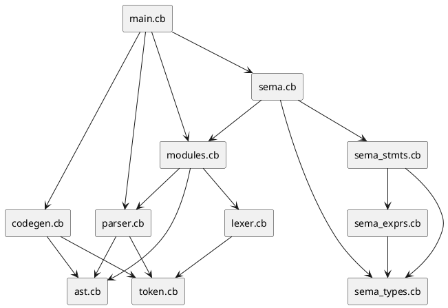

# CleanBasic Self-Hosting Implementation Plan

This document specifies the architecture, module layout, Flat Arena AST (`AstArena`), phased milestones, and 3-stage fixed-point verification workflow for building the self-hosted CleanBasic transpiler in `selfhost/`, while keeping `bootstrap/` intact as the Stage 0 (`cb0`) reference compiler.

---

## 1. Readiness Summary

### 1.1 Bootstrap Codebase Footprint (6,344 Non-Test Go LOC)

| Package / File | Files | Non-Test Go LOC | Role in Stage 0 (`cb0`) |
| :--- | :--- | ---: | :--- |
| `bootstrap/cmd/cb/main.go` | 1 | 293 | CLI (`check`, `emit`, `build`, `exec`) & temp Go build job runner |
| `bootstrap/internal/token/` | 1 | 213 | Token kinds, positions, single/two-word keyword tables |
| `bootstrap/internal/lexer/` | 1 | 512 | Scanner, escapes, byte/string/number literals, `go ... end go` blocks |
| `bootstrap/internal/ast/` | 1 | 667 | AST node interfaces, type representations, symbol structs |
| `bootstrap/internal/parser/` | 1 | 1,370 | Recursive-descent + precedence-climbing parser, Go reserved word checks |
| `bootstrap/internal/sema/` | 6 | 2,288 | Module loader, decl/type/expr/stmt/builtin semantic analysis |
| `bootstrap/internal/codegen/` | 4 | 1,001 | Go emitter, zero/auto-init emission, runtime helpers, `//line` directives |
| **Total** | **15** | **6,344** | Complete Stage 0 transpiler |

### 1.2 Test Suite & `-compiler=<bin>` Integration

- **Unit Test Suites (5 packages):** `bootstrap/cmd/cb`, `bootstrap/internal/lexer`, `bootstrap/internal/parser`, `bootstrap/internal/sema`, `bootstrap/internal/codegen`.
- **Integration & Error Test Suite:** `bootstrap/tests/runner_test.go` executes **19 test cases** under `tests/cases/` (11 positive end-to-end programs including multi-file modules, stdlib, concurrency, and Go interop; 8 compile-time error tests under `tests/cases/errors/`).
- **External Compiler Hook:** `bootstrap/tests/runner_test.go` (lines 18, 141–155) already supports `-compiler=<bin>`, invoking:
  ```text
  <bin> emit <entryPath> -o <outGoPath>
  ```
  and comparing `go run <outGoPath>` stdout against `// EXPECT_OUT:` or stderr against `// EXPECT_ERR:`.

### 1.3 Completed Pre-Self-Hosting Ergonomic Improvements

Four language and stdlib improvements were landed specifically to make `selfhost/` clean and idiomatic:
1. **`fs.mkdirTempIn(dir, pattern)`** (`std/fs.cb`): Creates temporary build directories inside `os.cacheDir()` or a target workspace.
2. **`os.writeStdout(msg)`** (`std/os.cb`): Writes raw strings to stdout without a trailing newline (essential for `cb emit` stdout mode or raw diagnostics).
3. **`list.sort()`** (`sema/builtins.go`, `codegen/exprs.go`): In-place `slices.Sort` on `list[int]`, `list[float]`, `list[str]`, and `list[byte]`, enabling deterministic sorted `import` and declaration emission.
4. **Recursive Struct `dict`/`mailbox` Auto-Initialization** (`codegen/codegen.go`, `codegen/stmts.go`): Zero-initialized structs (`dim a as AstArena`, `AstArena()`, and error-return zero values) recursively initialize all `dict` and `mailbox` fields—eliminating manual map initialization boilerplate across `AstArena`, `Scope`, and `ModuleInfo`.

---

## 2. Proposed `selfhost/` Module Layout

The self-hosted compiler is organized into **11 modules** under `selfhost/` with a strictly acyclic import DAG (CleanBasic forbids cyclic module imports):



### Module Responsibilities

| Module | Responsibility | `bootstrap/` Reference |
| :--- | :--- | :--- |
| `token.cb` | `Kind` (`token.Kind`), `Position`, `Token`, keyword & two-word coalescing tables | `internal/token/token.go` |
| `lexer.cb` | Character scanner, escapes, numbers, strings, bytes, `go ... end go` blocks | `internal/lexer/lexer.go` |
| `ast.cb` | `AstArena` (16 flat pools), node kinds, tagged-union structs, builder helpers | `internal/ast/ast.go` |
| `parser.cb` | Recursive-descent + precedence-climbing parser populating `AstArena` | `internal/parser/parser.go` |
| `modules.cb` | Recursive import graph loader, cycle detection, stdlib lookup, topo sort | `internal/sema/modules.go` |
| `sema_types.cb` | Type interning/resolution, comparability, recursive struct cycle checks, `Scope` helpers | `internal/sema/decls.go`, `sema.go` |
| `sema_exprs.cb` | Expression type inference, UFCS, struct ctors, `byref`, built-in methods | `internal/sema/exprs.go`, `builtins.go` |
| `sema_stmts.cb` | Statement checking, `can error` top-level rule, loops, `select`, `try/catch`, `defer` | `internal/sema/stmts.go` |
| `sema.cb` | Multi-module pass orchestration: predeclare -> types -> sigs -> globals -> bodies | `internal/sema/sema.go`, `decls.go` |
| `codegen.cb` | Deterministic Go emitter (`list[str]` + `.sort()`), zero-init, runtime helpers | `internal/codegen/*.go` |
| `main.cb` | CLI (`check`, `emit`, `build`, `exec`), `std/fs` + `std/os` build job runner | `cmd/cb/main.go` |

**Why split `sema` into 4 files?**
`bootstrap/internal/sema/` is **2,288 LOC**—36% of the entire compiler. Splitting into `sema_types.cb`, `sema_exprs.cb`, `sema_stmts.cb`, and `sema.cb` keeps each file focused (~400–600 LOC), prevents circular dependencies via a strict layering (`sema_types` -> `sema_exprs` -> `sema_stmts` -> `sema`), and makes milestone testing modular.

---

## 3. Detailed Flat Arena AST (`AstArena`) Design

### 3.1 Why a Flat Arena Instead of Go Interfaces/Pointers

1. **No Sum Types, Interfaces, or Pointers:** CleanBasic structs are pure value types, and recursive value structs are forbidden by `sema`. An AST node cannot hold `Expr` interface children or `*Expr` pointers.
2. **Addressable `list[T]` Elements:** CleanBasic's `checkMutableTarget` allows `byref` and in-place field mutation on `list[T]` elements (`a.exprs[id].semaTypeId = tyId`), avoiding value-copy bugs and Go map non-addressability.
3. **Copyable `int` Handles (`-1` = None):** Node IDs are plain `int` values that can be stored in `list[int]` child lists and `dict[str, int]` symbol tables without aliasing issues.
4. **Zero-Allocation `select case` Dispatch:** `select case a.exprs[id].kind` replaces Go type switches (`switch n := node.(type)`) with zero heap allocations or dynamic dispatch.

### 3.2 Complete CleanBasic `AstArena` Blueprint

All identifiers below are chosen to avoid CleanBasic keywords and all 33 Go reserved words (`goKeywords` / `goReservedWords`).

```cleanbasic
// selfhost/ast.cb — Flat Arena AST & Symbol Pool Blueprint
import "selfhost/token"

public enum TypeKind
    TyVoid
    TyInt
    TyFloat
    TyStr
    TyBool
    TyByte
    TyStruct
    TyEnum
    TyList
    TyDict
    TyMailbox
    TyErr
end enum

public type TypeNode
    kind as TypeKind
    name as str
    modId as str
    goName as str
    subTypeIds as list[int]
end type

public enum DeclKind
    DeclImport
    DeclGoImport
    DeclGoBlock
    DeclConst
    DeclVar
    DeclType
    DeclEnum
    DeclFn
end enum

public type DeclNode
    kind as DeclKind
    pos as token.Position
    isPublic as bool
    name as str
    alias as str
    path as str
    goCode as str
    goName as str
    typeId as int
    valueExprId as int
    fieldIds as list[int]
    paramIds as list[int]
    retTypeId as int
    canError as bool
    bodyStmtIds as list[int]
    variants as list[str]
    isGoDecl as bool
end type

public enum StmtKind
    StmtVarDecl
    StmtAssign
    StmtExpr
    StmtIf
    StmtForRange
    StmtForIn
    StmtWhile
    StmtSelect
    StmtTryCatch
    StmtDefer
    StmtStartJob
    StmtReturn
    StmtBreak
    StmtContinue
end enum

public type StmtNode
    kind as StmtKind
    pos as token.Position
    name as str
    typeId as int
    targetExprId as int
    valueExprId as int
    condExprId as int
    startExprId as int
    endExprId as int
    iterExprId as int
    loopVars as list[str]
    bodyStmtIds as list[int]
    elseIfIds as list[int]
    elseStmtIds as list[int]
    caseIds as list[int]
    hasElse as bool
    catchVar as str
    catchStmtIds as list[int]
    goName as str
    catchGoName as str
end type

public enum ExprKind
    ExprIdent
    ExprIntLit
    ExprFloatLit
    ExprStrLit
    ExprByteLit
    ExprBoolLit
    ExprListLit
    ExprDictLit
    ExprTypedEmpty
    ExprUnary
    ExprBinary
    ExprFieldAccess
    ExprIndex
    ExprSlice
    ExprCall
end enum

public type ExprNode
    kind as ExprKind
    pos as token.Position
    semaTypeId as int
    text as str
    intVal as int
    floatVal as float
    byteVal as byte
    boolVal as bool
    op as token.Kind
    leftId as int
    rightId as int
    targetId as int
    indexId as int
    startId as int
    endId as int
    childExprIds as list[int]
    dictEntryIds as list[int]
    ctorTypeId as int
    callInfoId as int
    goName as str
end type

public type ParamNode
    pos as token.Position
    name as str
    typeId as int
    byRef as bool
    goName as str
end type

public type FieldNode
    pos as token.Position
    name as str
    typeId as int
end type

public type ElseIfNode
    pos as token.Position
    condExprId as int
    bodyStmtIds as list[int]
end type

public type CaseNode
    pos as token.Position
    valueExprIds as list[int]
    bodyStmtIds as list[int]
end type

public type DictEntryNode
    pos as token.Position
    keyExprId as int
    valExprId as int
end type

public enum CallKind
    CallFunc
    CallStructCtor
    CallMethod
    CallUFCS
    CallErr
end enum

public type CallInfo
    kind as CallKind
    fnSymId as int
    structSymId as int
    recvExprId as int
    methodName as str
    canErr as bool
    hasValue as bool
end type

public type FnSymbol
    name as str
    goName as str
    modId as str
    isPublic as bool
    paramIds as list[int]
    retTypeId as int
    canErr as bool
    isGoBound as bool
    goTarget as str
    declId as int
end type

public type StructSymbol
    name as str
    goName as str
    modId as str
    isPublic as bool
    isGoType as bool
    fieldIds as list[int]
    fieldMap as dict[str, int]
end type

public type EnumSymbol
    name as str
    goName as str
    modId as str
    isPublic as bool
    variants as list[str]
    variantSet as dict[str, bool]
end type

public type VarSymbol
    name as str
    goName as str
    typeId as int
    isConst as bool
    isPublic as bool
    pos as token.Position
end type

public type Scope
    parentScopeId as int
    vars as dict[str, int]
end type

public type ModuleInfo
    id as str
    filePath as str
    isEntry as bool
    declIds as list[int]
    imports as dict[str, int]
    funcs as dict[str, int]
    structs as dict[str, int]
    enums as dict[str, int]
    globalScopeId as int
end type

public type AstArena
    types as list[TypeNode]
    decls as list[DeclNode]
    stmts as list[StmtNode]
    exprs as list[ExprNode]
    params as list[ParamNode]
    fields as list[FieldNode]
    cases as list[CaseNode]
    elseIfs as list[ElseIfNode]
    dictEntries as list[DictEntryNode]
    callInfos as list[CallInfo]
    fnSyms as list[FnSymbol]
    structSyms as list[StructSymbol]
    enumSyms as list[EnumSymbol]
    varSyms as list[VarSymbol]
    scopes as list[Scope]
    modules as list[ModuleInfo]
end type
```

### 3.3 Arena Builder Helpers

Each `add*` helper pushes a node onto its pool and returns the newly allocated `int` index (`count - 1`):

```cleanbasic
public fn addExpr(byref a as AstArena, node as ExprNode) as int
    dim idx = a.exprs.len()
    a.exprs.push(node)
    return idx
end fn

public fn addStmt(byref a as AstArena, node as StmtNode) as int
    dim idx = a.stmts.len()
    a.stmts.push(node)
    return idx
end fn

public fn addDecl(byref a as AstArena, node as DeclNode) as int
    dim idx = a.decls.len()
    a.decls.push(node)
    return idx
end fn

public fn addType(byref a as AstArena, node as TypeNode) as int
    dim idx = a.types.len()
    a.types.push(node)
    return idx
end fn
```

### 3.4 Sema Annotation & Lexical Scoping Pattern

- **In-Place AST Annotation:** Sema mutates `a.exprs[exprId].semaTypeId`, `a.exprs[exprId].callInfoId`, `a.exprs[exprId].goName`, and `a.params[paramId].byRef` directly in the arena.
- **Lexical Scope Chain (`parentScopeId`):** `Scope` stores `parentScopeId as int` (`-1` for module root) and `vars as dict[str, int]` mapping identifier names to `varSyms` indices:

```cleanbasic
public fn lookupVar(a as AstArena, scopeId as int, name as str) as int
    dim cur = scopeId
    while cur >= 0
        if a.scopes[cur].vars.contains(name)
            return a.scopes[cur].vars[name]
        end if
        cur = a.scopes[cur].parentScopeId
    end while
    return -1
end fn
```

### 3.5 Codegen Traversal Pattern

Codegen passes `byref a as AstArena` (or `byref ctx as EmitCtx` alongside `a as AstArena`) and an `int` node ID, dispatching with `select case` and appending chunks into a `list[str]` buffer:

```cleanbasic
fn emitExpr(byref a as AstArena, byref ctx as EmitCtx, exprId as int) as str
    select case a.exprs[exprId].kind
        case ast.ExprKind.ExprIntLit
            return "int64(" + a.exprs[exprId].intVal.toStr() + ")"
        case ast.ExprKind.ExprIdent
            if a.exprs[exprId].goName != ""
                return a.exprs[exprId].goName
            end if
            return a.exprs[exprId].text
        case ast.ExprKind.ExprBinary
            dim lhs = emitExpr(a, ctx, a.exprs[exprId].leftId)
            dim rhs = emitExpr(a, ctx, a.exprs[exprId].rightId)
            return "(" + lhs + " " + opStr(a.exprs[exprId].op) + " " + rhs + ")"
        case else
            return ""
    end select
end fn
```

---

## 4. Phased Milestones (Milestone 0 through Milestone 7)

| Milestone | Scope | `bootstrap/internal/` Reference | Verification Command |
| :--- | :--- | :--- | :--- |
| **M0: Skeleton & CLI** | `selfhost/main.cb` (`std/cli`, `std/fs`, `std/os`) | `cmd/cb/main.go` | `cb0 check selfhost/main.cb` |
| **M1: Token & Lexer** | `selfhost/token.cb`, `selfhost/lexer.cb` | `token/token.go`, `lexer/lexer.go` | `cb0 exec` token-dump test on `tests/cases/01_hello_and_math.cb` |
| **M2: Arena AST & Parser** | `selfhost/ast.cb`, `selfhost/parser.cb` | `ast/ast.go`, `parser/parser.go` | `cb0 check selfhost/parser.cb` + AST round-trip smoke test |
| **M3: Module Loader** | `selfhost/modules.cb` (imports, stdlib, topo sort) | `sema/modules.go` | Multi-file import graph test on `07_multi_file_modules/main.cb` |
| **M4: Sema Types & Decls** | `selfhost/sema_types.cb`, `selfhost/sema.cb` | `sema/sema.go`, `sema/decls.go` | `cb0 check selfhost/sema.cb` |
| **M5: Sema Exprs & Stmts** | `selfhost/sema_exprs.cb`, `selfhost/sema_stmts.cb` | `sema/exprs.go`, `builtins.go`, `stmts.go` | `cb0 check` passes on all 11 positive + rejects all 8 error cases |
| **M6: Go Codegen** | `selfhost/codegen.cb` | `codegen/*.go` | `cb0 build selfhost/main.cb -o build/cb1` + `runner_test.go -compiler=../../build/cb1` |
| **M7: 3-Stage Fixed Point** | Full `cb0 -> cb1 -> cb2 -> stage3.go` | All packages | `diff -u build/stage2.go build/stage3.go` (0 diff) + full `runner_test.go` on `cb2` |

---

## 5. 3-Stage Bootstrap Fixed-Point Verification

Once `selfhost/main.cb` compiles and passes the test suite as `cb1`, run the 3-stage fixed-point bootstrap:

```bash
mkdir -p build

# Stage 0: Build bootstrap compiler (cb0)
go build -o build/cb0 ./bootstrap/cmd/cb

# Stage 1: cb0 compiles selfhost/main.cb -> build/cb1
./build/cb0 build selfhost/main.cb -o build/cb1

# Stage 2: cb1 compiles selfhost/main.cb -> build/stage2.go and build/cb2
./build/cb1 emit selfhost/main.cb -o build/stage2.go
./build/cb1 build selfhost/main.cb -o build/cb2

# Stage 3: cb2 compiles selfhost/main.cb -> build/stage3.go
./build/cb2 emit selfhost/main.cb -o build/stage3.go

# Fixed-point check: Stage 2 and Stage 3 generated Go must be byte-for-byte identical
diff -u build/stage2.go build/stage3.go

# Full integration & compile-error test suite executed using Stage 2 compiler
go test ./bootstrap/tests/... -v -args -compiler=../../build/cb2
```

### Fixed-Point Determinism Invariants

To guarantee `diff -u build/stage2.go build/stage3.go` produces **zero differences**:
1. **Sorted Imports:** Collect all Go import paths into a `list[str]` and call `.sort()` before emitting `import (...)`.
2. **No Raw `dict` Iteration in Codegen:** Emit top-level structs, enums, globals, and functions in deterministic declaration/module-topological order (`list[int]` IDs), never by iterating over a `dict`.
3. **Consistent `//line` Paths:** Normalize file paths with `fs.clean` / `fs.abs` identically in both `cb1` and `cb2`.
