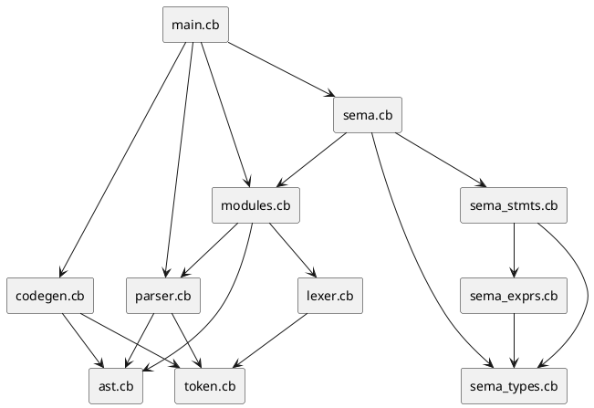

# CleanBasic Self-Hosting Implementation Plan

This document specifies the architecture, module layout, Flat Arena AST (`AstArena`), phased milestones, and 3-stage fixed-point verification workflow for building the self-hosted CleanBasic transpiler in `selfhost/`, while keeping `bootstrap/` intact as the Stage 0 (`cb0`) reference compiler.

---

## 1. Readiness Summary

### 1.1 Bootstrap Codebase Footprint (6,344 Non-Test Go LOC)

| Package / File | Files | Non-Test Go LOC | Role in Stage 0 (`cb0`) |
| :--- | :--- | ---: | :--- |
| `bootstrap/cmd/cb/main.go` | 1 | 293 | CLI (`check`, `emit`, `build`, `run`) & temp Go build job runner |
| `bootstrap/internal/token/` | 1 | 213 | Token kinds, positions, single/two-word keyword tables |
| `bootstrap/internal/lexer/` | 1 | 512 | Scanner, escapes, byte/string/number literals, `go ... end go` blocks |
| `bootstrap/internal/ast/` | 1 | 667 | AST node interfaces, type representations, symbol structs |
| `bootstrap/internal/parser/` | 1 | 1,370 | Recursive-descent + precedence-climbing parser, Go reserved word checks |
| `bootstrap/internal/sema/` | 6 | 2,288 | Module loader, decl/type/expr/stmt/builtin semantic analysis |
| `bootstrap/internal/codegen/` | 4 | 1,001 | Go emitter, zero/auto-init emission, runtime helpers, `//line` directives |
| **Total** | **15** | **6,344** | Complete Stage 0 transpiler |

### 1.2 Test Suite & `-compiler=<bin>` Integration

- **Unit Test Suites (5 packages):** `bootstrap/cmd/cb`, `bootstrap/internal/lexer`, `bootstrap/internal/parser`, `bootstrap/internal/sema`, `bootstrap/internal/codegen`.
- **Integration & Error Test Suite:** `bootstrap/tests/runner_test.go` executes **19 test cases** under `tests/cases/` (11 positive end-to-end programs including multi-file modules, stdlib, concurrency, and Go interop; 8 compile-time error tests under `tests/cases/errors/`).
- **External Compiler Hook:** `bootstrap/tests/runner_test.go` (lines 18, 141–155) already supports `-compiler=<bin>`, invoking:
  ```text
  <bin> emit <entryPath> -o <outGoPath>
  ```
  and comparing `go run <outGoPath>` stdout against `// EXPECT_OUT:` or stderr against `// EXPECT_ERR:`.

### 1.3 Completed Pre-Self-Hosting Ergonomic Improvements

Four language and stdlib improvements were landed specifically to make `selfhost/` clean and idiomatic:
1. **`fs.mkdirTempIn(dir, pattern)`** (`std/fs.cb`): Creates temporary build directories inside `os.cacheDir()` or a target workspace.
2. **`os.writeStdout(msg)`** (`std/os.cb`): Writes raw strings to stdout without a trailing newline (essential for `cb emit` stdout mode or raw diagnostics).
3. **`list.sort()`** (`sema/builtins.go`, `codegen/exprs.go`): In-place `slices.Sort` on `list[int]`, `list[float]`, `list[str]`, and `list[byte]`, enabling deterministic sorted `import` and declaration emission.
4. **Recursive Struct `dict` Auto-Initialization** (`codegen/codegen.go`, `codegen/stmts.go`): Zero-initialized structs (`dim a as AstArena`, `AstArena()`, and error-return zero values) recursively initialize all `dict` fields—eliminating manual map initialization boilerplate across `AstArena`, `Scope`, and `ModuleInfo`.

---

## 2. Proposed `selfhost/` Module Layout

The self-hosted compiler is organized into **11 modules** under `selfhost/` with a strictly acyclic import DAG (CleanBasic forbids cyclic module imports):



### Module Responsibilities

| Module | Responsibility | `bootstrap/` Reference |
| :--- | :--- | :--- |
| `token.cb` | `Kind` (`token.Kind`), `Position`, `Token`, keyword & two-word coalescing tables | `internal/token/token.go` |
| `lexer.cb` | Character scanner, escapes, numbers, strings, bytes, `go ... end go` blocks | `internal/lexer/lexer.go` |
| `ast.cb` | `AstArena` (16 flat pools), node kinds, tagged-union structs, builder helpers | `internal/ast/ast.go` |
| `parser.cb` | Recursive-descent + precedence-climbing parser populating `AstArena` | `internal/parser/parser.go` |
| `modules.cb` | Recursive import graph loader, cycle detection, stdlib lookup, topo sort | `internal/sema/modules.go` |
| `sema_types.cb` | Type interning/resolution, comparability, recursive struct cycle checks, `Scope` helpers | `internal/sema/decls.go`, `sema.go` |
| `sema_exprs.cb` | Expression type inference, UFCS, struct ctors, `byref`, built-in methods | `internal/sema/exprs.go`, `builtins.go` |
| `sema_stmts.cb` | Statement checking, `can error` top-level rule, loops, `select`, `try/catch`, `defer` | `internal/sema/stmts.go` |
| `sema.cb` | Multi-module pass orchestration: predeclare -> types -> sigs -> globals -> bodies | `internal/sema/sema.go`, `decls.go` |
| `codegen.cb` | Deterministic Go emitter (`list[str]` + `.sort()`), zero-init, runtime helpers | `internal/codegen/*.go` |
| `main.cb` | CLI (`check`, `emit`, `build`, `run`), `std/fs` + `std/os` build job runner | `cmd/cb/main.go` |

**Why split `sema` into 4 files?**
`bootstrap/internal/sema/` is **2,288 LOC**—36% of the entire compiler. Splitting into `sema_types.cb`, `sema_exprs.cb`, `sema_stmts.cb`, and `sema.cb` keeps each file focused (~400–600 LOC), prevents circular dependencies via a strict layering (`sema_types` -> `sema_exprs` -> `sema_stmts` -> `sema`), and makes milestone testing modular.

---

## 3. Detailed Flat Arena AST (`AstArena`) Design

### 3.1 Why a Flat Arena Instead of Go Interfaces/Pointers

1. **No Sum Types, Interfaces, or Pointers:** CleanBasic structs are pure value types, and recursive value structs are forbidden by `sema`. An AST node cannot hold `Expr` interface children or `*Expr` pointers.
2. **Addressable `list[T]` Elements:** CleanBasic's `checkMutableTarget` allows `byref` and in-place field mutation on `list[T]` elements (`a.exprs[id].semaTypeId = tyId`), avoiding value-copy bugs and Go map non-addressability.
3. **Copyable `int` Handles (`-1` = None):** Node IDs are plain `int` values that can be stored in `list[int]` child lists and `dict[str, int]` symbol tables without aliasing issues.
4. **Zero-Allocation `select case` Dispatch:** `select case a.exprs[id].kind` replaces Go type switches (`switch n := node.(type)`) with zero heap allocations or dynamic dispatch.

### 3.2 Complete CleanBasic `AstArena` Blueprint

All identifiers below are chosen to avoid CleanBasic keywords, all 43 Go/runtime reserved words (`goKeywords` / `goPredeclaredWords`), and the reserved `_cb_` prefix.

```cleanbasic
// selfhost/ast.cb — Flat Arena AST & Symbol Pool Blueprint
import "selfhost/token"

public enum TypeKind
    TyVoid
    TyInt
    TyFloat
    TyStr
    TyBool
    TyByte
    TyStruct
    TyEnum
    TyList
    TyDict
    TyJob
    TyErr
end enum

public type TypeNode
    kind as TypeKind
    pos as token.Position
    name as str
    modId as str
    goName as str
    subTypeIds as list[int]
end type

public enum DeclKind
    DeclImport
    DeclGoImport
    DeclGoBlock
    DeclConst
    DeclVar
    DeclType
    DeclEnum
    DeclFn
end enum

public type DeclNode
    kind as DeclKind
    pos as token.Position
    isPublic as bool
    name as str
    alias as str
    path as str
    goCode as str
    goName as str
    typeId as int
    valueExprId as int
    fieldIds as list[int]
    paramIds as list[int]
    retTypeId as int
    canError as bool
    bodyStmtIds as list[int]
    variants as list[str]
    isGoDecl as bool
    goTarget as str
end type

public enum StmtKind
    StmtVarDecl
    StmtAssign
    StmtExpr
    StmtIf
    StmtForRange
    StmtForIn
    StmtWhile
    StmtSelect
    StmtTryCatch
    StmtDefer
    StmtReturn
    StmtBreak
    StmtContinue
end enum

public type StmtNode
    kind as StmtKind
    pos as token.Position
    name as str
    typeId as int
    targetExprId as int
    valueExprId as int
    condExprId as int
    startExprId as int
    endExprId as int
    iterExprId as int
    loopVars as list[str]
    bodyStmtIds as list[int]
    elseIfIds as list[int]
    elseStmtIds as list[int]
    caseIds as list[int]
    hasElse as bool
    catchVar as str
    catchStmtIds as list[int]
    callExprId as int
    goName as str
    catchGoName as str
end type

public enum ExprKind
    ExprIdent
    ExprIntLit
    ExprFloatLit
    ExprStrLit
    ExprByteLit
    ExprBoolLit
    ExprListLit
    ExprDictLit
    ExprTypedEmpty
    ExprUnary
    ExprBinary
    ExprFieldAccess
    ExprIndex
    ExprSlice
    ExprCall
end enum

public type ExprNode
    kind as ExprKind
    pos as token.Position
    semaTypeId as int
    text as str
    intVal as int
    floatVal as float
    byteVal as byte
    boolVal as bool
    op as token.Kind
    leftId as int
    rightId as int
    targetId as int
    indexId as int
    startId as int
    endId as int
    childExprIds as list[int]
    dictEntryIds as list[int]
    ctorTypeId as int
    callInfoId as int
    byRef as bool
    goName as str
end type

public type ParamNode
    pos as token.Position
    name as str
    typeId as int
    byRef as bool
    goName as str
end type

public type FieldNode
    pos as token.Position
    name as str
    typeId as int
end type

public type ElseIfNode
    pos as token.Position
    condExprId as int
    bodyStmtIds as list[int]
end type

public type CaseNode
    pos as token.Position
    valueExprIds as list[int]
    bodyStmtIds as list[int]
end type

public type DictEntryNode
    pos as token.Position
    keyExprId as int
    valExprId as int
end type

public enum CallKind
    CallFunc
    CallStructCtor
    CallMethod
    CallUFCS
    CallErr
end enum

public type CallInfo
    kind as CallKind
    fnSymId as int
    structSymId as int
    recvExprId as int
    methodName as str
    canErr as bool
    hasValue as bool
end type

public type FnSymbol
    pos as token.Position
    name as str
    goName as str
    modId as str
    isPublic as bool
    paramIds as list[int]
    retTypeId as int
    canErr as bool
    isGoBound as bool
    goTarget as str
    declId as int
end type

public type StructSymbol
    name as str
    goName as str
    modId as str
    isPublic as bool
    isGoType as bool
    fieldIds as list[int]
    fieldMap as dict[str, int]
end type

public type EnumSymbol
    name as str
    goName as str
    modId as str
    isPublic as bool
    variants as list[str]
    variantSet as dict[str, bool]
end type

public type VarSymbol
    name as str
    goName as str
    typeId as int
    isConst as bool
    isPublic as bool
    byRef as bool
    pos as token.Position
end type

public type Scope
    parentScopeId as int
    vars as dict[str, int]
end type

public type ModuleInfo
    id as str
    filePath as str
    sanitizedId as str
    isEntry as bool
    declIds as list[int]
    imports as dict[str, int]
    funcs as dict[str, int]
    structs as dict[str, int]
    enums as dict[str, int]
    globalScopeId as int
end type

public type AstArena
    types as list[TypeNode]
    decls as list[DeclNode]
    stmts as list[StmtNode]
    exprs as list[ExprNode]
    params as list[ParamNode]
    fields as list[FieldNode]
    cases as list[CaseNode]
    elseIfs as list[ElseIfNode]
    dictEntries as list[DictEntryNode]
    callInfos as list[CallInfo]
    fnSyms as list[FnSymbol]
    structSyms as list[StructSymbol]
    enumSyms as list[EnumSymbol]
    varSyms as list[VarSymbol]
    scopes as list[Scope]
    modules as list[ModuleInfo]
end type
```

### 3.3 Arena Builder Helpers

Each `add*` helper pushes a node onto its pool and returns the newly allocated `int` index (`count - 1`):

```cleanbasic
public fn addExpr(byref a as AstArena, node as ExprNode) as int
    dim idx = a.exprs.len()
    a.exprs.push(node)
    return idx
end fn

public fn addStmt(byref a as AstArena, node as StmtNode) as int
    dim idx = a.stmts.len()
    a.stmts.push(node)
    return idx
end fn

public fn addDecl(byref a as AstArena, node as DeclNode) as int
    dim idx = a.decls.len()
    a.decls.push(node)
    return idx
end fn

public fn addType(byref a as AstArena, node as TypeNode) as int
    dim idx = a.types.len()
    a.types.push(node)
    return idx
end fn
```

### 3.4 Sema Annotation & Lexical Scoping Pattern

- **In-Place AST Annotation:** Sema mutates `a.exprs[exprId].semaTypeId`, `a.exprs[exprId].callInfoId`, `a.exprs[exprId].goName`, and `a.params[paramId].byRef` directly in the arena.
- **Lexical Scope Chain (`parentScopeId`):** `Scope` stores `parentScopeId as int` (`-1` for module root) and `vars as dict[str, int]` mapping identifier names to `varSyms` indices:

```cleanbasic
public fn lookupVar(a as AstArena, scopeId as int, name as str) as int
    dim cur = scopeId
    while cur >= 0
        if a.scopes[cur].vars.contains(name)
            return a.scopes[cur].vars[name]
        end if
        cur = a.scopes[cur].parentScopeId
    end while
    return -1
end fn
```

### 3.5 Codegen Traversal Pattern

Codegen passes `byref a as AstArena` (or `byref ctx as EmitCtx` alongside `a as AstArena`) and an `int` node ID, dispatching with `select case` and appending chunks into a `list[str]` buffer:

```cleanbasic
fn emitExpr(byref a as AstArena, byref ctx as EmitCtx, exprId as int) as str
    select case a.exprs[exprId].kind
        case ast.ExprKind.ExprIntLit
            return "int64(" + a.exprs[exprId].intVal.toStr() + ")"
        case ast.ExprKind.ExprIdent
            if a.exprs[exprId].goName != ""
                return a.exprs[exprId].goName
            end if
            return a.exprs[exprId].text
        case ast.ExprKind.ExprBinary
            dim lhs = emitExpr(a, ctx, a.exprs[exprId].leftId)
            dim rhs = emitExpr(a, ctx, a.exprs[exprId].rightId)
            return "(" + lhs + " " + opStr(a.exprs[exprId].op) + " " + rhs + ")"
        case else
            return ""
    end select
end fn
```

---

## 4. Module-by-Module Implementation Blueprint

Each module below follows the acyclic import DAG in Section 2 and maps 1-to-1 to its `bootstrap/` reference package. Every module specification includes its Go reference summary, CleanBasic types and signatures, parity checklist, translation gotchas, and concrete verification gate.

---

### 4.1 `selfhost/token.cb` ← `bootstrap/internal/token/token.go`

#### Go Reference Summary
- **Source File:** `bootstrap/internal/token/token.go` (213 LOC)
- **Key Types:**
  - `Position` (`File string`, `Line int`, `Column int`, 1-based) with `Position.String()` returning `file:line:col` (or `line:col` if `File == ""`).
  - `Kind` (`string`): **83 token kinds** grouped into:
    - Special (2): `EOF`, `NEWLINE`.
    - Identifiers & Literals (7): `IDENT`, `INT_LIT`, `FLOAT_LIT`, `STRING_LIT`, `BYTE_LIT`, `TRUE`, `FALSE`.
    - Single-word Keywords (27): `IMPORT`, `AS`, `PUBLIC`, `CONST`, `DIM`, `TYPE`, `ENUM`, `FN`, `GO`, `BYREF`, `IF`, `ELSE`, `FOR`, `TO`, `IN`, `WHILE`, `CASE`, `TRY`, `CATCH`, `DEFER`, `RETURN`, `BREAK`, `CONTINUE`, `AND`, `OR`, `NOT`, `START`.
    - Built-in Type / Container Keywords (9): `INT`, `FLOAT`, `STR`, `BOOL`, `BYTE`, `ERR`, `LIST`, `DICT`, `JOB`.
    - Transitional Single Words (3): `END`, `SELECT`, `CAN`.
    - Two-word Coalesced Keywords (14): `ELSE_IF`, `END_FN`, `END_IF`, `END_FOR`, `END_WHILE`, `END_SELECT`, `END_TRY`, `END_DEFER`, `END_TYPE`, `END_ENUM`, `GO_IMPORT`, `SELECT_CASE`, `CASE_ELSE`, `CAN_ERROR`.
    - Verbatim Go Block (1): `GO_BLOCK`.
    - Operators & Punctuation (20): `ASSIGN`, `EQ`, `NEQ`, `LT`, `GT`, `LTE`, `GTE`, `PLUS`, `MINUS`, `STAR`, `SLASH`, `PERCENT`, `DOT`, `COMMA`, `COLON`, `LPAREN`, `RPAREN`, `LBRACKET`, `RBRACKET`, `LBRACE`, `RBRACE`.
  - `Token` (`Kind Kind`, `Lexeme string`, `Pos Position`).
- **Core Functions & Tables:**
  - `singleWordKeywords`: `map[string]Kind` with **41 entries** (27 keywords + 9 built-in types + 3 transitional words + `true`/`false`).
  - `twoWordKeywords`: `map[twoWordKey]Kind` with **14 pairs**.
  - `LookupIdent(word string) Kind` and `CoalesceTwoWordKeyword(first, second string) (Kind, string, bool)`.

#### CleanBasic Design & Key Types/Functions
- Define `public enum Kind` with unambiguous `Tok*` variant names (avoiding CleanBasic keywords and Go reserved words like `type`, `func`, `map`, `range`, `switch`, `default`, `error`):
  - `TokEOF`, `TokNewline`, `TokIdent`, `TokIntLit`, `TokFloatLit`, `TokStrLit`, `TokByteLit`, `TokTrue`, `TokFalse`
  - `TokImport`, `TokAs`, `TokPublic`, `TokConst`, `TokDim`, `TokType`, `TokEnum`, `TokFn`, `TokGo`, `TokByref`, `TokIf`, `TokElse`, `TokFor`, `TokTo`, `TokIn`, `TokWhile`, `TokCase`, `TokTry`, `TokCatch`, `TokDefer`, `TokReturn`, `TokBreak`, `TokContinue`, `TokAnd`, `TokOr`, `TokNot`, `TokStart`
  - `TokInt`, `TokFloat`, `TokStr`, `TokBool`, `TokByte`, `TokErr`, `TokList`, `TokDict`, `TokJob`
  - `TokEnd`, `TokSelect`, `TokCan`
  - `TokElseIf`, `TokEndFn`, `TokEndIf`, `TokEndFor`, `TokEndWhile`, `TokEndSelect`, `TokEndTry`, `TokEndDefer`, `TokEndType`, `TokEndEnum`, `TokGoImport`, `TokSelectCase`, `TokCaseElse`, `TokCanError`
  - `TokGoBlock`
  - `TokAssign`, `TokEq`, `TokNeq`, `TokLt`, `TokGt`, `TokLte`, `TokGte`, `TokPlus`, `TokMinus`, `TokStar`, `TokSlash`, `TokPercent`, `TokDot`, `TokComma`, `TokColon`, `TokLParen`, `TokRParen`, `TokLBracket`, `TokRBracket`, `TokLBrace`, `TokRBrace`
- **Structs & Functions:**
```cleanbasic
public type Position
    file as str
    line as int
    col as int
end type

public type Token
    kind as Kind
    lexeme as str
    pos as Position
end type

public type CoalesceResult
    matched as bool
    kind as Kind
    lexeme as str
end type

public fn posString(p as Position) as str
public fn kindString(k as Kind) as str
public fn lookupIdent(word as str) as Kind
public fn coalesceTwoWordKeyword(first as str, second as str) as CoalesceResult
```

#### Parity & Behavior Checklist
- All 83 `Kind` variants map 1-to-1 to `bootstrap/internal/token/token.go` and `kindString(k)` returns the exact Go `Kind` string (e.g. `"else if"`, `"INT_LIT"`, `"="`) for identical error diagnostics.
- `posString(p)` formats `file:line:col` when `p.file != ""`, else `line:col`.
- `lookupIdent(word)` checks all 40 single-word keywords and returns `Kind.TokIdent` otherwise.
- `coalesceTwoWordKeyword(first, second)` matches all 15 two-word pairs and returns `first + " " + second` as `lexeme`.

#### CleanBasic Translation Notes / Gotchas
- **No Go Reserved Words in Enum Variants or Parameters:** Never name an enum variant `Error` or `Type` or `Go` without a prefix; `Tok*` avoids all collisions.
- **Composite Key Workaround:** CleanBasic `dict` keys can be `str`—encode two-word pairs in a module-level `dict[str, Kind]` keyed by `first + " " + second` (e.g., `"else if"`, `"end fn"`, `"can error"`). Build or lazy-initialize the lookup `dict` inside a helper function if top-level `dict` literal syntax is verbose.
- **Zero-Allocation `CoalesceResult`:** CleanBasic functions return a single value, so return `CoalesceResult(true, k, first + " " + second)` instead of Go's 3-tuple `(Kind, string, bool)`.

#### Module Verification Gate
- `./build/cb0 check selfhost/token.cb`
- Smoke test (`cb0 run`) asserting `lookupIdent("fn") == Kind.TokFn`, `lookupIdent("myVar") == Kind.TokIdent`, `coalesceTwoWordKeyword("can", "error").matched == true`, and `kindString(Kind.TokSelectCase) == "select case"`.

---

### 4.2 `selfhost/lexer.cb` ← `bootstrap/internal/lexer/lexer.go`

#### Go Reference Summary
- **Source File:** `bootstrap/internal/lexer/lexer.go` (512 LOC)
- **Key Types:** `LexError` (`Pos`, `Message`; `Error()` formats `"%s: syntax error: %s"`), `Lexer` (`file`, `src`, `pos`, `line`, `col`).
- **Core Functions:** `Tokenize(src, filename)`, `scanAll()`, `scanIdentifier()`, `scanNumber()`, `scanString()`, `scanEscapeSequence()`, `scanByteLiteral()`, `scanGoBlock(startPos)`, `isRestOfLineEmptyOrComment()`, `isEndGoDirective(trimmed)`, `scanNextToken()`, `coalesceKeywords(raw)`.
- **Subtle Invariants:**
  - **Newline Normalization:** Leading blank lines are suppressed (`len(tokens) == 0`); consecutive `NEWLINE` tokens are collapsed to one; a trailing `NEWLINE` is injected before `EOF` if any non-newline token was emitted.
  - **Comments:** `//` skips to `\n` (leaving the `\n` to be scanned normally).
  - **Standalone `go ... end go` Blocks:** Only triggered when an identifier at the start of a line (first token or immediately after `NEWLINE`) is `go` AND `isRestOfLineEmptyOrComment()` is true. `isEndGoDirective` matches `end` + horizontal whitespace + `go` + (EOL or whitespace or `//`). Lines inside the block strip trailing `\r` and preserve `\n`.
  - **Escapes (7 total):** `\n`, `\r`, `\t`, `\`, `'`, `"`, `\0`. Unterminated or unknown escapes return `LexError`.
  - **Byte Literals:** Single quotes; rejects empty `''`, unterminated, multi-char, and non-ASCII (`ch >= 0x80`).
  - **Numbers:** Leading digits; optional `.` followed by at least one digit produces `FLOAT_LIT`, otherwise `INT_LIT`.
  - **C-Style Logical Operator Rejection:** `&&`, `||`, and standalone `!` produce explicit `LexError` messages (`use 'and' instead`, `use 'or' instead`, `use 'not' instead`); `!=` produces `NEQ`.
  - **Two-Word Coalescing:** `coalesceKeywords` only coalesces `raw[i]` and `raw[i+1]` when `raw[i].Pos.Line == raw[i+1].Pos.Line`.

#### CleanBasic Design & Key Types/Functions
```cleanbasic
type Lexer
    file as str
    src as str
    pos as int
    line as int
    col as int
end type

public fn tokenize(src as str, filename as str) as list[token.Token] can error
fn scanAll(byref l as Lexer) as list[token.Token] can error
fn scanNextToken(byref l as Lexer) as token.Token can error
fn scanIdentifier(byref l as Lexer) as token.Token
fn scanNumber(byref l as Lexer) as token.Token can error
fn scanString(byref l as Lexer) as token.Token can error
fn scanByteLiteral(byref l as Lexer) as token.Token can error
fn scanEscapeSequence(byref l as Lexer) as byte can error
fn scanGoBlock(byref l as Lexer, startPos as token.Position) as token.Token can error
fn isRestOfLineEmptyOrComment(l as Lexer) as bool
fn isEndGoDirective(trimmed as str) as bool
fn coalesceKeywords(raw as list[token.Token]) as list[token.Token]
```

#### Parity & Behavior Checklist
- Exact `<pos>: syntax error: <msg>` formatting via `error(token.posString(pos) + ": syntax error: " + msg)`.
- `go ... end go` only activates at line start when `isRestOfLineEmptyOrComment` holds; `go import "fmt"` and `= go "os.Exit"` are **not** treated as `GO_BLOCK`.
- `coalesceKeywords` checks `raw[i].pos.line == raw[i + 1].pos.line` before calling `token.coalesceTwoWordKeyword`.
- Strings decode escape sequences into the stored `lexeme` (not raw source escapes); byte literals store a 1-byte string or decoded byte.

#### CleanBasic Translation Notes / Gotchas
- **Byte Indexing:** In CleanBasic, `l.src[l.pos]` returns `byte` (not `str`). Compare against byte literals (`' '`, `'\n'`, `'0'`, `'9'`, `'a'`, `'z'`) and check `ch.toInt() >= 128` for non-ASCII rejection in `scanByteLiteral`.
- **String Accumulation:** Use `list[str]` + `.join("")` or `ch.toStr()` / `intVal.toChar()` when building decoded string literals; avoid `str` concatenation in tight loops over huge inputs where `list[str].push(...)` + `.join("")` is cleaner.
- **Top-Level Fallible Call Rule:** Every call to `scanEscapeSequence`, `scanString`, `scanNumber`, `scanByteLiteral`, `scanGoBlock`, `scanNextToken`, and `scanAll` must be a top-level statement or RHS of `dim` / `=`—never nested inside `tokens.push(scanNextToken(l))`.

#### Module Verification Gate
- `./build/cb0 check selfhost/lexer.cb`
- Token-dump smoke test via `cb0 run` on `tests/cases/01_hello_and_math.cb` and `tests/cases/09_bytes_slices_and_go_interop.cb` (verifying `GO_BLOCK`, `BYTE_LIT`, `GO_IMPORT`, and two-word coalescing).
- Negative lexer test verifying `tests/cases/errors/01_lex_unterminated_string.cb` fails with `syntax error:` at the exact line/column.

---

### 4.3 `selfhost/ast.cb` ← `bootstrap/internal/ast/ast.go`

#### Go Reference Summary
- **Source File:** `bootstrap/internal/ast/ast.go` (667 LOC)
- **Key Types:**
  - `Program` (`File string`, `Decls []TopLevelDecl`).
  - Interfaces: `TopLevelDecl`, `Statement`, `Expr`.
  - Type System: `TypeKind` (12 kinds), `Type` (`Kind`, `Name`, `ModuleID`, `GoName`, `SubTypes []Type`), `Elem()`, `Key()`, `Val()`, `String()`, `IsVoid()`, `Equals(other)`, plus primitive constants (`VoidType`, `IntType`, `FloatType`, `StrType`, `BoolType`, `ByteType`, `ErrType`).
  - Symbol Structs: `ParamSymbol`, `FnSymbol`, `FieldSymbol`, `StructSymbol`, `EnumSymbol`, `CallKind` (5 kinds), `CallInfo`.
  - Decl Nodes (8): `ImportDecl`, `GoImportDecl`, `GoBlockDecl`, `ConstDecl`, `TypeDecl`, `EnumDecl`, `FnDecl`, `VarDecl` (implements both `TopLevelDecl` and `Statement`).
  - Stmt Nodes (13): `VarDecl`, `Assignment`, `ExprStmt`, `IfStmt`, `ForStmt` (range + for-in), `WhileStmt`, `SelectStmt`, `TryCatchStmt`, `DeferStmt`, `ReturnStmt`, `BreakStmt`, `ContinueStmt`.
  - Expr Nodes (15): `IdentExpr`, `IntLitExpr`, `FloatLitExpr`, `StringLitExpr`, `ByteLitExpr`, `BoolLitExpr`, `ListLitExpr`, `DictLitExpr`, `TypedEmptyCtorExpr`, `UnaryExpr`, `BinaryExpr`, `FieldAccessExpr`, `IndexExpr`, `SliceExpr`, `CallExpr`.

#### CleanBasic Design & Key Types/Functions
- Uses the **16-pool `AstArena`** defined in Section 3.2 with `-1` as the "none / unset" ID sentinel.
- **Primitive Type IDs:** Initialize 7 canonical primitive `TypeNode` entries at arena creation (`initArena() as AstArena`, with constants `TyIdVoid = 0` .. `TyIdErr = 6`) so primitive comparisons can check `typeId == ast.TyIdInt` or `a.types[typeId].kind`.
- **Node Field Usage by Kind (Key Mappings):**
  - `DeclNode`: `DeclImport` (`path`, `alias`); `DeclGoImport` (`path`, `alias`); `DeclGoBlock` (`goCode`); `DeclConst` (`isPublic`, `name`, `typeId`, `valueExprId`); `DeclVar` (`isPublic`, `name`, `typeId`, `valueExprId`); `DeclType` (`isPublic`, `name`, `isGoDecl`, `goName`, `fieldIds`); `DeclEnum` (`isPublic`, `name`, `variants`); `DeclFn` (`isPublic`, `name`, `paramIds`, `retTypeId`, `canError`, `isGoDecl`, `goTarget`, `bodyStmtIds`).
  - `StmtNode`: `StmtVarDecl` (`name`, `typeId`, `valueExprId`); `StmtAssign` (`targetExprId`, `valueExprId`); `StmtExpr` (`valueExprId`); `StmtIf` (`condExprId`, `bodyStmtIds`, `elseIfIds`, `hasElse`, `elseStmtIds`); `StmtForRange` (`name`, `startExprId`, `endExprId`, `bodyStmtIds`); `StmtForIn` (`loopVars`, `iterExprId`, `bodyStmtIds`); `StmtWhile` (`condExprId`, `bodyStmtIds`); `StmtSelect` (`targetExprId`, `caseIds`, `hasElse`, `elseStmtIds`); `StmtTryCatch` (`bodyStmtIds`, `catchVar`, `catchStmtIds`); `StmtDefer` (`bodyStmtIds`); `StmtStartJob` (`callExprId`); `StmtReturn` (`valueExprId`).
  - `ExprNode`: `ExprIdent` (`text`, `goName`); `ExprIntLit` (`intVal`); `ExprFloatLit` (`floatVal`); `ExprStrLit` (`text`); `ExprByteLit` (`byteVal`); `ExprBoolLit` (`boolVal`); `ExprListLit` (`childExprIds`); `ExprDictLit` (`dictEntryIds`); `ExprTypedEmpty` (`ctorTypeId`); `ExprStart` (`callExprId`); `ExprUnary` (`op`, `rightId`); `ExprBinary` (`op`, `leftId`, `rightId`); `ExprFieldAccess` (`targetId`, `text`, `goName`); `ExprIndex` (`targetId`, `indexId`); `ExprSlice` (`targetId`, `startId`, `endId`); `ExprCall` (`targetId`, `childExprIds`, `callInfoId`).
- **Required Helpers:**
```cleanbasic
public fn initArena() as AstArena
public fn addType(byref a as AstArena, node as TypeNode) as int
public fn addDecl(byref a as AstArena, node as DeclNode) as int
public fn addStmt(byref a as AstArena, node as StmtNode) as int
public fn addExpr(byref a as AstArena, node as ExprNode) as int
public fn addParam(byref a as AstArena, node as ParamNode) as int
public fn addField(byref a as AstArena, node as FieldNode) as int
public fn addCase(byref a as AstArena, node as CaseNode) as int
public fn addElseIf(byref a as AstArena, node as ElseIfNode) as int
public fn addDictEntry(byref a as AstArena, node as DictEntryNode) as int
public fn addCallInfo(byref a as AstArena, node as CallInfo) as int
public fn typeElem(a as AstArena, typeId as int) as int
public fn typeKey(a as AstArena, typeId as int) as int
public fn typeVal(a as AstArena, typeId as int) as int
public fn typeIsVoid(a as AstArena, typeId as int) as bool
public fn typeEquals(a as AstArena, leftId as int, rightId as int) as bool
public fn typeString(a as AstArena, typeId as int) as str
```

#### Parity & Behavior Checklist
- `typeEquals(a, leftId, rightId)` matches Go's `Type.Equals`: checks `kind`, `name`, `modId`, `subTypeIds.len()`, and recursively compares each subtype pair.
- `typeString(a, typeId)` formats `list[T]`, `dict[K, V]`, `job[T]`, `job`, `void`, primitive names, and struct/enum names identically to `Type.String()`.
- `typeElem`, `typeKey`, `typeVal` return `-1` (or `TyIdVoid`) when out of bounds.

#### CleanBasic Translation Notes / Gotchas
- **Zero-Init of `AstArena`:** Thanks to recursive struct `dict` auto-initialization, `dim a = AstArena()` initializes all 16 `list[...]` pools to empty and all nested `dict` fields on `Scope`, `ModuleInfo`, `StructSymbol`, `EnumSymbol` to non-nil maps automatically.
- **Defaulting `int` IDs to `-1`:** CleanBasic zero-initializes `int` fields to `0`, **not** `-1`. Always provide factory constructors (e.g., `newExprNode(kind, pos)`, `newStmtNode(kind, pos)`, `newDeclNode(kind, pos)`) that initialize all ID fields (`typeId`, `semaTypeId`, `leftId`, `rightId`, `targetId`, `callInfoId`, etc.) to `-1`.

#### Module Verification Gate
- `./build/cb0 check selfhost/ast.cb`
- Unit smoke test constructing a small AST in `AstArena`, verifying `typeEquals` on nested `list[dict[str, int]]`, and verifying `typeString`.

---

### 4.4 `selfhost/parser.cb` ← `bootstrap/internal/parser/parser.go`

#### Go Reference Summary
- **Source File:** `bootstrap/internal/parser/parser.go` (1,370 LOC)
- **Key Types:** `ParseError` (`Pos`, `Message`; `Error()` formats `"%s: syntax error: %s"`), `Parser` (`tokens []token.Token`, `pos int`, `file string`).
- **Core Functions:**
  - Top-level: `Parse(src, filename)`, `ParseProgram()`, `parseTopLevelDecl()`, `parseImportDecl()`, `parseGoImportDecl()`, `parseConstDecl()`, `parseTypeDecl()`, `parseEnumDecl()`, `parseFnDecl()`, `parseParamList()`, `parseType()`.
  - Statements: `parseStatement()`, `parseVarDecl()`, `parseAssignOrExprStmt()`, `parseIfStmt()`, `parseForStmt()`, `finishForStmt()`, `parseWhileStmt()`, `parseSelectStmt()`, `parseTryCatchStmt()`, `parseDeferStmt()`, `parseReturnStmt()`.
  - Expressions: `parseExpr()`, `parseBinaryExpr(minPrec)`, `parseNotExpr()`, `parseUnaryExpr()`, `parsePostfixExpr()`, `parsePrimaryExpr()`, `parseTypedEmptyCtor()`, `parseListLiteral()`, `parseDictLiteral()`.
- **Subtle Invariants:**
  - **Go Reserved Word Enforcement:**
    - `goKeywords` (**12** words): `chan`, `default`, `fallthrough`, `func`, `goto`, `interface`, `map`, `package`, `range`, `struct`, `switch`, `var`. Checked in `expectMemberIdent` (struct field names, enum variants, and `.` member access).
    - `goPredeclaredWords` (**31** words = 23 Go predeclared/stdlib names `any`, `append`, `close`, `copy`, `delete`, `error`, `errors`, `float64`, `fmt`, `int64`, `len`, `make`, `new`, `nil`, `os`, `panic`, `println`, `recover`, `rune`, `slices`, `strconv`, `string`, `strings` + 8 runtime/internal names `_cb_os`, `cb_main`, `cbDictGet`, `cbDictContains`, `cbJob`, `cbStartJob`, `cbVoidJob`, `cbStartVoidJob`) plus any identifier with the `_cb_` prefix (**43** total words). Checked in `expectIdent` (all variable, param, const, type, enum, fn, alias, and primary identifier positions).
  - **Operator Precedence Ladder (lowest to highest):**
    - Level 1: `or`
    - Level 2: `and`
    - Level 3: `not` (prefix, lower than comparisons)
    - Level 4: `==`, `!=`, `<`, `>`, `<=`, `>=`
    - Level 5: `+`, `-`
    - Level 6: `*`, `/`, `%`
    - Prefix Unary: `-`, `+`
    - Postfix (left-associative): `.member`, `(args)`, `[index]` / `[start:end]`
  - **Multi-line Delimited Lists:** `hasMoreDelimited(endKind)` skips newlines inside `(...)`, `[...]`, `{...}`, allowing multi-line params, args, list literals, and dict literals with optional trailing commas.
  - **`start` Expression:** `parseStartExpr` parses a postfix expression and requires it to be a `CallExpr` (`expected function call after 'start'`).
  - **Empty `[]` / `{}` Rejection:** `parseListLiteral` and `parseDictLiteral` reject empty `[]` and `{}`, directing users to `list[T]()` / `dict[K, V]()`.
  - **Numeric Literal Parsing:** `strconv.ParseInt(..., 0, 64)` and `strconv.ParseFloat(..., 64)` validate literals during parsing.

#### CleanBasic Design & Key Types/Functions
```cleanbasic
type Parser
    tokens as list[token.Token]
    pos as int
    file as str
end type

public fn parse(byref a as AstArena, src as str, filename as str) as list[int] can error
fn cur(p as Parser) as token.Token
fn peek(p as Parser, offset as int) as token.Token
fn advance(byref p as Parser) as token.Token
fn matchTok(byref p as Parser, kind as token.Kind) as bool
fn expect(byref p as Parser, kind as token.Kind, ctx as str) as token.Token can error
fn expectIdent(byref p as Parser, ctx as str) as token.Token can error
fn expectMemberIdent(byref p as Parser, ctx as str) as token.Token can error
fn parseTopLevelDecl(byref a as AstArena, byref p as Parser) as int can error
fn parseStatement(byref a as AstArena, byref p as Parser) as int can error
fn parseExpr(byref a as AstArena, byref p as Parser) as int can error
fn parseBinaryExpr(byref a as AstArena, byref p as Parser, minPrec as int) as int can error
fn parsePostfixExpr(byref a as AstArena, byref p as Parser) as int can error
fn parsePrimaryExpr(byref a as AstArena, byref p as Parser) as int can error
```

#### Parity & Behavior Checklist
- Exact same 12 `goKeywords`, 31 `goPredeclaredWords` (43 total), and `_cb_` prefix rule with error message: `"cannot use Go reserved word \"" + lexeme + "\" as an identifier"`.
- All top-level forms supported: `import "..." [as alias]`, `go import "..." [as alias]`, `GO_BLOCK`, `[public] const`, `[public] dim`, `[public] type Name = go "GoType"`, `[public] type Name ... end type`, `[public] enum Name ... end enum`, `[public] fn ... [as T] [can error] = go "Target"`, `[public] fn ... end fn`.
- `for` disambiguates `for i = start to end` vs `for x in iter` vs `for k, v in iter`.
- `parsePostfixExpr` handles `target[:]`, `target[start:]`, `target[:end]`, `target[start:end]`, and `target[index]`.
- `parseTypedEmptyCtor` handles `list[T]()` and `dict[K, V]()`.

#### CleanBasic Translation Notes / Gotchas
- **`cur` / `peek` / `advance`:** Check `p.pos + offset >= p.tokens.len()` and return the final `TokEOF` token so out-of-bounds panics never occur.
- **`str.toInt()` / `str.toFloat()` are `can error`:** Always call them as standalone `dim n = tok.lexeme.toInt()` statements inside `parsePrimaryExpr` (never nested inside `ast.ExprNode(...)`), catching or propagating the error with `syntax error:` position context if needed.
- **No Nested Fallible Calls:** Every `parse*` call returns `int` `can error`—always bind the returned ID to a `dim` variable before storing it into `childExprIds`, `DeclNode`, or `StmtNode`.

#### Module Verification Gate
- `./build/cb0 check selfhost/parser.cb`
- Parse all 11 positive test files under `tests/cases/*.cb` via a `cb0 run` parser smoke harness.
- Negative parser test verifying `tests/cases/errors/02_parse_unclosed_if.cb` fails with `syntax error:` at the expected position.

---

### 4.5 `selfhost/modules.cb` ← `bootstrap/internal/sema/modules.go`

#### Go Reference Summary
- **Source File:** `bootstrap/internal/sema/modules.go` (289 LOC)
- **Key Types:**
  - `ModuleInfo` (`ID`, `FilePath`, `SanitizedID`, `IsEntry`, `Program`, `Imports`, `Functions`, `Structs`, `Enums`, `GlobalVars`).
  - `moduleLoader` (`rootDir`, `state map[string]int` where `0=unvisited`, `1=visiting`, `2=done`, `modules map[string]*ModuleInfo`, `byID map[string]*ModuleInfo`, `topoOrder []*ModuleInfo`, `stack []string`).
- **Core Functions:**
  - `sanitizeModuleID(id)`: replaces any non-ASCII-alphanumeric byte with `_`; if the result starts with `'0'..'9'`, prepends `_`.
  - `symbolGoName(name)`: returns `name` if `IsEntry`, else `fmt.Sprintf("%s__%s", m.SanitizedID, name)`.
  - `canonicalID(absPath)`: relative path from `rootDir` using forward slashes, stripping `.cb`.
  - `loadEntry(entryPath, entryProg)`, `visitFile(absPath, preParsed, isEntry, overrideID)`, `getOrCreateStdlib(modPath, pos)`, `findStdlibFile(rootDir, modPath)`.
- **Subtle Invariants:**
  - **Default Import Alias:** For `std/foo/bar`, `path.Base` yields `bar`; for local `"combat/actions.cb"`, strips `.cb` after taking base name (`actions`). Duplicate aliases in the same module fail with `duplicate import alias`.
  - **DFS 3-State Cycle Detection & Topo Sort:** `state[key] == 1` during recursion reports `circular import detected: a -> b -> a`; `topoOrder` appends each module **after** all its dependencies are visited (dependencies before dependents).
  - **Stdlib Search Order:**
    1. `CB_STDLIB_DIR` environment variable.
    2. `<exeDir>/std` and `<exeDir>/../std` (via `os.Executable()`).
    3. Ancestor directory walk (`<dir>/std`) starting from `rootDir`.
    4. Ancestor directory walk starting from `os.Getwd()`.
    5. (`runtime.Caller(0)` fallback is Go-toolchain-specific and omitted in `cb1`.)
  - Rejects empty `std/` subpaths or `..` in stdlib paths.

#### CleanBasic Design & Key Types/Functions
```cleanbasic
type ModuleLoader
    rootDir as str
    state as dict[str, int]
    modulesByPath as dict[str, int]
    byId as dict[str, int]
    topoOrder as list[int]
    stack as list[str]
end type

public fn sanitizeModuleId(id as str) as str
public fn symbolGoName(m as ast.ModuleInfo, name as str) as str
public fn loadEntry(byref a as ast.AstArena, entryPath as str) as list[int] can error
fn visitFile(byref a as ast.AstArena, byref loader as ModuleLoader, absPath as str, isEntry as bool, overrideId as str) as int can error
fn getOrCreateStdlib(byref a as ast.AstArena, byref loader as ModuleLoader, modPath as str, pos as token.Position) as int can error
fn findStdlibFile(rootDir as str, modPath as str) as str
```

#### Parity & Behavior Checklist
- `sanitizeModuleId` prefixes `_` when the sanitized string starts with `0..9` (critical for `07_multi_file_modules` and numbered module folders).
- `symbolGoName` leaves entry module symbols unmangled and prefixes non-entry module symbols with `<sanitizedId>__`.
- `loadEntry` returns `topoOrder` (list of `ast.ModuleInfo` IDs in `a.modules`) with entry module last.
- `findStdlibFile` checks `os.getEnv("CB_STDLIB_DIR")`, `os.executable()` (`std` and `../std`), `rootDir` ancestors, and `os.cwd()` ancestors in exact order, deduplicating cleaned paths.

#### CleanBasic Translation Notes / Gotchas
- **`std/fs` + `std/os` Usage:** Use `fs.abs`, `fs.clean`, `fs.dir`, `fs.base`, `fs.join`, `fs.rel`, `fs.exists`, `fs.isDir`, `fs.readFile`, and `os.getEnv` / `os.executable` / `os.cwd`.
- **Slash Normalization:** Normalize `\` to `/` via `.replace("\\", "/")` before `canonicalID` and `//line` emission.
- **No `defer` Mutation of `loader.stack`:** CleanBasic `defer` runs at function exit, so pop `loader.stack` explicitly before returning instead of using `defer`.

#### Module Verification Gate
- `./build/cb0 check selfhost/modules.cb`
- Load `tests/cases/07_multi_file_modules/main.cb` and `tests/cases/08_stdlib.cb` via a `cb0 run` harness, verifying `topoOrder` length, `sanitizedId`, and `std/cli`, `std/fs`, `std/os`, `std/regex` resolution.

---

### 4.6 `selfhost/sema_types.cb` ← `bootstrap/internal/sema/sema.go` & `decls.go`

#### Go Reference Summary
- **Source Files:** `bootstrap/internal/sema/sema.go` (234 LOC) and `bootstrap/internal/sema/decls.go` (442 LOC)
- **Key Types:**
  - `SemaError` (`Pos`, `Message`; `Error()` formats `"%s: type error: %s"`).
  - `VarSymbol`, `Scope` (`parent *Scope`, `vars map[string]*VarSymbol`; `Define`, `Lookup`).
  - `analyzer` (`prog`, `mod`, `currentFn`, `loopDepth`, `tryDepth`, `deferDepth`, `allowedFallibleExpr`, `startCall`, `fnGlobalAccess`, `fnCallees`, `startSites`).
- **Core Functions:**
  - Scope & Type Helpers: `NewScope`, `Scope.Define`, `Scope.Lookup`, `lookupStruct`, `isComparableType`.
  - Declaration & Type Resolution: `predeclareType`, `resolveTypeDecl`, `checkRecursiveStructFields`, `validateStructFieldTypes`, `structReaches`, `resolveEnumDecl`, `registerFnDecl`, `resolveVarDeclType`, `registerTopLevelVar`, `analyzeTopLevelConst`, `analyzeTopLevelVar`, `resolveType`, `validateType`, `resolveTypeNodes`.
- **Subtle Invariants:**
  - **Recursive Value Struct Cycle Detection:** `structReaches(t, target, visited)` returns `false` for `KindList`, `KindDict`, and `KindJob`, and recursively traverses `KindStruct` fields (skipping `IsGoType`) to reject direct or mutually recursive value struct fields (`type Node ... next as Node`).
  - **`isComparableType` / `isSendableType`:** `isComparableType` returns `true` for `int`, `float`, `str`, `byte`, `bool`, `enum`, and non-`go` `struct` types whose fields are all recursively comparable; `isSendableType` returns `true` for those plus `err`, and `false` for `void`, `list`, `dict`, `job`, and `type ... = go "..."`.
  - **`validateStructFieldTypes`:** Runs **after** `checkRecursiveStructFields` (Pass 0.6) so `isComparableType` on `dict[K, V]` fields never infinite-loops on cyclic structs.
  - **Function & Param Validation:** `registerFnDecl` checks duplicate param names, resolves param/return types, sets `goName = a.mod.symbolGoName(fn.Name)` (or `"cb_main"` for entry `main`, or `fn.GoTarget` for `= go "..."`), and rejects `byref` on `go`-bound functions.

#### CleanBasic Design & Key Types/Functions
```cleanbasic
public type SemaCtx
    modIds as list[int]
    curModId as int
    curFnSymId as int
    loopDepth as int
    tryDepth as int
    deferDepth as int
    allowedFallibleExprId as int
    startCallId as int
end type

public fn semaErr(pos as token.Position, msg as str) as str
public fn newScope(byref a as ast.AstArena, parentScopeId as int) as int
public fn defineVar(byref a as ast.AstArena, scopeId as int, sym as ast.VarSymbol) as int can error
public fn lookupVar(a as ast.AstArena, scopeId as int, name as str) as int
public fn lookupStructSym(a as ast.AstArena, curModId as int, typeId as int) as int
public fn isComparableType(a as ast.AstArena, curModId as int, typeId as int) as bool
public fn resolveType(byref a as ast.AstArena, curModId as int, typeId as int) as int can error
public fn validateType(a as ast.AstArena, curModId as int, typeId as int) can error
public fn predeclareType(a as ast.AstArena, modId as int, name as str, pos as token.Position) can error
public fn resolveTypeDecl(byref a as ast.AstArena, modId as int, declId as int) can error
public fn checkRecursiveStructFields(a as ast.AstArena, modId as int) can error
public fn validateStructFieldTypes(a as ast.AstArena, modId as int) can error
public fn resolveEnumDecl(byref a as ast.AstArena, modId as int, declId as int) can error
public fn registerFnDecl(byref a as ast.AstArena, modId as int, declId as int) can error
```

#### Parity & Behavior Checklist
- Error messages use exact `<pos>: type error: <msg>` prefix.
- `resolveType` resolves imported qualified types (`modAlias.TypeName`) by checking `mod.imports[modAlias]` and verifying `isPublic` when crossing module boundaries.
- `validateType` rejects non-comparable `dict` key types and `void` in variable/field/param positions.
- `registerFnDecl` sets `goName = "cb_main"` when `mod.isEntry and fn.name == "main"` (otherwise `symbolGoName`).

#### CleanBasic Translation Notes / Gotchas
- **Mutating Arena Nodes by Index:** Use `a.structSyms[symId].fieldIds.push(fid)` and `a.structSyms[symId].fieldMap[fname] = fid` directly on `list[StructSymbol]` elements inside `byref a as ast.AstArena`.
- **`resolveTypeNodes` Creates New `TypeNode`s:** When resolving a `TypeStruct`/`TypeList`/`TypeDict`/`TypeJob`, resolve subtype IDs first (in `dim` variables—no nested fallible calls!) and allocate or update the resolved `TypeNode` in `a.types`.

#### Module Verification Gate
- `./build/cb0 check selfhost/sema_types.cb`
- Unit smoke test verifying `isComparableType` (struct with `list` field -> `false`, struct with `int`+`str` -> `true`) and `checkRecursiveStructFields` rejecting `type A; b as A; end type` (`tests/cases/errors/08_recursive_struct_cycle.cb`).

---

### 4.7 `selfhost/sema_exprs.cb` ← `bootstrap/internal/sema/exprs.go` & `builtins.go`

#### Go Reference Summary
- **Source Files:** `bootstrap/internal/sema/exprs.go` (557 LOC) and `bootstrap/internal/sema/builtins.go` (184 LOC)
- **Core Functions:**
  - `inferExpr(expr, scope)`, `inferUnaryExpr`, `inferBinaryExpr`, `inferListLitExpr`, `inferDictLitExpr`, `inferTypedEmptyCtorExpr`, `inferFieldAccessExpr`, `inferIndexExpr`, `inferSliceExpr`, `inferCallExpr`, `inFallibleContext`, `inferErrorCall`, `inferStructCtorCall`, `checkByRefArg`, `validateCallArgs`, `expectPositionalArgs`, `inferMethodOrUFCSCall`.
  - Built-ins (`builtins.go`): `finishBuiltinCall`, `finishFallibleBuiltinCall`, `inferBuiltinMethodCall`.
- **Subtle Invariants:**
  - **Operators:** Unary `-`/`+` on `int`/`float`/`byte`; `not` on `bool`. Binary `+` on `int`, `float`, `byte`, or `str` (concatenation); `-`, `*`, `/` on `int`, `float`, `byte`; `%` on `int`, `byte`; comparisons (`<`, `<=`, `>`, `>=`) on `int`, `float`, `str`, `byte`; equality (`==`, `!=`) on any comparable type (plus `enum`); `and`/`or` on `bool`.
  - **27 Built-in Methods Across 8 Receiver Kinds:**
    - `list[T]`: `len() -> int`, `push(T) -> void` (requires mutable target), `join(str) -> str` (only `list[str]`), `sort() -> void` (only `int`/`float`/`str`/`byte`, requires mutable target).
    - `dict[K, V]`: `len() -> int`, `get(K, V) -> V`, `contains(K) -> bool`, `remove(K) -> void` (requires mutable target via `unwrapMutableDictTarget`).
    - `str`: `len() -> int`, `trim() -> str`, `toUpper() -> str`, `toLower() -> str`, `toStr() -> str`, `quote() -> str`, `toInt() -> int` (**fallible**), `toFloat() -> float` (**fallible**), `split(str) -> list[str]`, `contains(str) -> bool`, `startsWith(str) -> bool`, `endsWith(str) -> bool`, `indexOf(str) -> int`, `replace(str, str) -> str`.
    - `int`: `toByte() -> byte`, `toChar() -> str`, `toStr() -> str`.
    - `float`: `toStr() -> str`.
    - `bool`: `toStr() -> str`.
    - `byte`: `toInt() -> int`, `toStr() -> str`.
    - `job[T]` / `job`: `wait() -> T` (or `void`).
  - **UFCS 3-Step Lookup Order:** On `recv.method(args...)`:
    1. If `recv` is an import alias (`ExprIdent` matching `mod.imports`), resolve module-qualified function `imp.funcs[method]` (must be `isPublic`).
    2. Otherwise infer `recv`'s type and check `inferBuiltinMethodCall`.
    3. Otherwise look up UFCS function `method` in `a.mod.funcs` (must accept `recvType` as first param).
  - **Struct Constructors:** Positional-only, accepting either `0` args (zero-init) or `len(fields)` args; rejects `type ... = go "..."` ctors with args.
  - **Fallible Call Context:** `can error` functions/methods and `error(msg)` require `inFallibleContext()` (`tryDepth > 0` or `currentFn.canErr`) AND `exprId == ctx.allowedFallibleExprId` (unless `exprId == ctx.startCallId`).
  - **`byref` Arguments:** `checkByRefArg` requires an addressable mutable target (`ExprIdent` non-const/non-loop-var, `ExprFieldAccess` on mutable struct, or `ExprIndex` on mutable `list`).

#### CleanBasic Design & Key Types/Functions
```cleanbasic
public fn inferExpr(byref a as ast.AstArena, byref ctx as sema_types.SemaCtx, exprId as int, scopeId as int) as int can error
public fn checkMutableTarget(a as ast.AstArena, ctx as sema_types.SemaCtx, exprId as int, scopeId as int) can error
public fn unwrapMutableDictTarget(a as ast.AstArena, exprId as int) as int
fn inferBuiltinMethodCall(byref a as ast.AstArena, byref ctx as sema_types.SemaCtx, callId as int, recvId as int, recvTypeId as int, method as str, scopeId as int) as int can error
fn inferMethodOrUFCSCall(byref a as ast.AstArena, byref ctx as sema_types.SemaCtx, callId as int, faId as int, scopeId as int) as int can error
fn validateCallArgs(byref a as ast.AstArena, byref ctx as sema_types.SemaCtx, callId as int, argIds as list[int], paramIds as list[int], fnName as str, canErr as bool, scopeId as int) can error
```

#### Parity & Behavior Checklist
- `ExprNode.semaTypeId` is always populated on every inferred expression (codegen relies on `a.exprs[id].semaTypeId`).
- `ExprFieldAccess` handles: (1) import alias -> module-qualified `const`/`dim` (`goName` set to `sym.goName`), (2) `EnumName.Variant` (sets `semaTypeId` to enum type), (3) `errVar.msg` (on `KindErr`, returns `StrType`), (4) struct field lookup (rejects field access on `go` opaque types).
- `ExprIndex` handles `list[T]` (index `int` -> `T`), `str` (index `int` -> `byte`), and `dict[K, V]` (index `K` -> `V`).
- `ExprSlice` handles `list[T]` and `str` with optional `startId`/`endId` (`int`).
- `error(msg)` requires `msg` of type `str`, sets `CallKind.CallErr`, and returns `TyIdVoid`.

#### CleanBasic Translation Notes / Gotchas
- **Boolean Flag Return for `inferBuiltinMethodCall`:** In Go, `inferBuiltinMethodCall` returns `(Type, bool, error)`. In CleanBasic, return `int` (`-1` if no built-in matched, `>= 0` for the matched `TypeId`) `can error`.
- **`allowedFallibleExprId` Clearing:** Save and clear `ctx.allowedFallibleExprId = -1` before recursing into sub-expressions/arguments so nested fallible calls inside arguments are properly rejected.

#### Module Verification Gate
- `./build/cb0 check selfhost/sema_exprs.cb`
- Verified together with `sema_stmts.cb` and `sema.cb` in Milestone M5 against all 11 positive + 8 error cases (especially `tests/cases/03_structs_and_ufcs.cb`, `04_containers_and_strings.cb`, `errors/03_type_mismatch.cb`, `errors/05_unhandled_can_error.cb`, `errors/06_nested_fallible_call.cb`, `errors/07_invalid_byref_arg.cb`).

---

### 4.8 `selfhost/sema_stmts.cb` ← `bootstrap/internal/sema/stmts.go`

#### Go Reference Summary
- **Source File:** `bootstrap/internal/sema/stmts.go` (582 LOC)
- **Core Functions:**
  - `analyzeFnBody(fn)`, `blockAlwaysReturns(stmts)`, `analyzeStmt(stmt, scope)`, `inferStartExpr(e, scope)`, `validateStartJobIsolation()`, `inferRootExpr(expr, scope)`, `analyzeVarDecl(s, scope)`, `unwrapMutableDictTarget(expr)`, `checkMutableTarget(expr, scope)`, `analyzeAssignment(s, scope)`, `analyzeIfStmt(s, scope)`, `analyzeWhileStmt(s, scope)`, `analyzeForStmt(s, scope)`, `analyzeLoopBody(stmts, loopScope)`, `analyzeSelectStmt(s, scope)`, `analyzeTryCatchStmt(s, scope)`, `analyzeDeferStmt(s, scope)`, `analyzeReturnStmt(s, scope)`.
- **Subtle Invariants:**
  - **`blockAlwaysReturns`:** Recognizes `ReturnStmt`, `ExprStmt` calling `error(...)`, `IfStmt` (when `HasElse` and `Then`, all `ElseIfs`, and `Else` all return), `SelectStmt` (when `HasElse` and all cases + `Else` return), and `TryCatchStmt` (when both `TryBody` and `CatchBody` return).
  - **`inferRootExpr`:** Temporarily sets `ctx.allowedFallibleExprId = exprId` only for the root RHS of `VarDecl`, `Assignment`, `ReturnStmt`, or `ExprStmt`, then restores it to `-1`.
  - **`inferStartExpr` & `validateStartJobIsolation`:** Rejects `can error` targets and `byref` parameters, enforces `isSendableType` on all arguments (and UFCS receiver), and performs a Pass 4 call-graph BFS to reject direct or transitive access to mutable module-level `dim` variables (while allowing `list`/`dict` returns and eager caller-goroutine argument capture in codegen).
  - **`defer` Isolation:** `analyzeDeferStmt` saves and zeroes `tryDepth` and `loopDepth`, increments `deferDepth`, and restores them on exit—so `return`, `break`, `continue`, and unhandled `can error` calls from enclosing `try`/`can error` functions are rejected inside `defer`.
  - **Loop Variable Immutability:** `for` range and `for-in` variables are defined with `isConst = true` in `loopScope` so mutating them is rejected.
  - **`select case`:** Supports `int`, `str`, `byte`, and `enum` targets (rejects `bool`, `float`, structs, containers).

#### CleanBasic Design & Key Types/Functions
```cleanbasic
public fn analyzeFnBody(byref a as ast.AstArena, byref ctx as sema_types.SemaCtx, declId as int) can error
public fn analyzeStmt(byref a as ast.AstArena, byref ctx as sema_types.SemaCtx, stmtId as int, scopeId as int) can error
public fn blockAlwaysReturns(a as ast.AstArena, stmtIds as list[int]) as bool
fn inferRootExpr(byref a as ast.AstArena, byref ctx as sema_types.SemaCtx, exprId as int, scopeId as int) as int can error
fn analyzeVarDecl(byref a as ast.AstArena, byref ctx as sema_types.SemaCtx, stmtId as int, scopeId as int) can error
fn analyzeAssignment(byref a as ast.AstArena, byref ctx as sema_types.SemaCtx, stmtId as int, scopeId as int) can error
fn analyzeForStmt(byref a as ast.AstArena, byref ctx as sema_types.SemaCtx, stmtId as int, scopeId as int) can error
fn analyzeTryCatchStmt(byref a as ast.AstArena, byref ctx as sema_types.SemaCtx, stmtId as int, scopeId as int) can error
fn analyzeDeferStmt(byref a as ast.AstArena, byref ctx as sema_types.SemaCtx, stmtId as int, scopeId as int) can error
fn analyzeReturnStmt(byref a as ast.AstArena, byref ctx as sema_types.SemaCtx, stmtId as int, scopeId as int) can error
```

#### Parity & Behavior Checklist
- `checkMutableTarget` allows `dict[k]` assignment even when indexing into a nested `dict`, while still rejecting `const` or loop-variable roots via `unwrapMutableDictTarget`.
- `break` and `continue` check `ctx.loopDepth > 0`.
- Non-`void` functions must satisfy `blockAlwaysReturns(fn.bodyStmtIds)` unless `fn.isGoDecl`.
- `try ... catch errVar` defines `errVar` with `TyIdErr` in `catchScope` and increments `ctx.tryDepth` only for `tryBody`.

#### CleanBasic Translation Notes / Gotchas
- **Restoring `tryDepth` / `loopDepth` / `deferDepth` Without `defer`:** Save `prevTry = ctx.tryDepth`, `prevLoop = ctx.loopDepth`, etc., and restore them explicitly after the recursive `analyzeStmt` loop (if an error is thrown, `can error` aborts the entire compilation).

#### Module Verification Gate
- `./build/cb0 check selfhost/sema_stmts.cb`
- Tested via `sema.cb` against `tests/cases/05_enums_and_select.cb`, `06_errors_and_defer.cb`, `10_concurrency_and_recursive_types.cb`, `11_control_flow_and_codegen_edges.cb`, and `tests/cases/errors/04_const_and_loop_var_mutation.cb`.

---

### 4.9 `selfhost/sema.cb` ← `bootstrap/internal/sema/sema.go` & `decls.go`

#### Go Reference Summary
- **Source Files:** `bootstrap/internal/sema/sema.go` (234 LOC) and `bootstrap/internal/sema/decls.go` (442 LOC)
- **Core Functions:**
  - `LoadAndAnalyze(entryPath)`, `AnalyzeSource(src, filename)`, `Analyze(prog)`.
  - `analyzeProgram(prog)` executing the **strict 6-step pass order** per module in `topoOrder`:
    1. **Pass 0:** Pre-declare all `type` and `enum` names in `mod.structs` / `mod.enums`, checking for duplicates.
    2. **Pass 0.5:** Resolve struct field types (`resolveTypeDecl`) and enum variants (`resolveEnumDecl`).
    3. **Pass 0.6:** Reject direct/mutually recursive value struct fields (`checkRecursiveStructFields`), then validate `dict` key comparability in struct fields (`validateStructFieldTypes`).
    4. **Pass 1:** Register all top-level `fn` signatures (`registerFnDecl`), allowing mutual recursion and forward calls.
    5. **Pass 2:** Analyze top-level `const` and `dim` declarations in source order (`analyzeTopLevelConst`, `analyzeTopLevelVar`).
    6. **Pass 3:** Analyze all non-`go` function bodies (`analyzeFnBody`).
- **Subtle Invariants:**
  - **Built-in `print`:** Registered in each module's `funcs["print"]` with signature `print(msg as str) -> void` before `analyzeProgram`.
  - **Module Topological Order:** Dependencies are analyzed completely before dependents so imported `public` types, functions, constants, and globals are already resolved.

#### CleanBasic Design & Key Types/Functions
```cleanbasic
public fn loadAndAnalyze(byref a as ast.AstArena, entryPath as str) as list[int] can error
public fn analyzeModule(byref a as ast.AstArena, byref ctx as sema_types.SemaCtx, modId as int) can error
fn registerBuiltinPrint(byref a as ast.AstArena, modId as int)
fn analyzeTopLevelConst(byref a as ast.AstArena, byref ctx as sema_types.SemaCtx, modId as int, declId as int) can error
fn analyzeTopLevelVar(byref a as ast.AstArena, byref ctx as sema_types.SemaCtx, modId as int, declId as int) can error
```

#### Parity & Behavior Checklist
- Calls `modules.loadEntry(a, entryPath)` to obtain `topoOrder`.
- Registers `print(msg as str)` in every module before running Pass 0..3.
- Executes Pass 0 -> 0.5 -> 0.6 -> 1 -> 2 -> 3 in exact order for each module in `topoOrder`.
- Top-level `const` and `dim` initializers run with `tryDepth == 0` and `curFnSymId == -1`, rejecting top-level `can error` calls.

#### CleanBasic Translation Notes / Gotchas
- **Entry `main` Signature:** Validate if `entryMod.funcs.contains("main")`, checking that `main` has 0 parameters and returns `void` or `int` (matching Go codegen's `cb_main()` wrapper expectations).

#### Module Verification Gate
- `./build/cb0 check selfhost/sema.cb`
- Run a `cb0 run` semantic-check harness over **all 11 positive test files** (`tests/cases/*.cb` -> exit 0) and **all 8 error test files** (`tests/cases/errors/*.cb` -> exit 1 with matching `EXPECT_ERR` substring).

---

### 4.10 `selfhost/codegen.cb` ← `bootstrap/internal/codegen/{codegen,exprs,stmts,runtime}.go`

#### Go Reference Summary
- **Source Files:** `codegen.go` (422 LOC), `exprs.go` (273 LOC), `stmts.go` (274 LOC), `runtime.go` (32 LOC) — **1,001 LOC total**.
- **Key Types:**
  - `Options` (`EmitLineDirectives bool`).
  - `emitter` (`emitLineDirectives`, `prog`, `currentMod`, `currentFnSym`, `imports map[string]bool`, `goImports map[string]string`, `usedDictGet`, `usedDictContains`, `currentFn`, `currentTryID`, `tryCounter`, `errCounter`, `loopCounter`).
- **Core Functions:**
  - Entry: `EmitGo`, `EmitGoWithOptions`, `emitProgram`, `emitFnHeader`, `emitGoBoundFn`, `emitFn`.
  - Types & Zero-Init: `goSemaType`, `structNeedsFieldInit`, `emitZeroStruct`, `goSemaZeroValue`.
  - Expressions: `emitBuiltinCall`, `emitExpr`, `emitArgExpr`, `fnGoName`, `effectiveCallArgs`, `emitCallExprRaw`.
  - Statements: `emitZeroOrInitVarDecl`, `emitStmtList`, `emitErrorJumpOrReturn`, `emitFallibleCallExpr`, `emitRhs`, `emitStmt`.
  - Runtime: `emitRuntimeHelpers` (`cbDictGet`, `cbDictContains`).
- **Subtle Invariants:**
  - **Deterministic Imports:** `useImport` / `useGoImport` record imports during body emission; `formatImportLines()` deduplicates and sorts them lexicographically before emitting `package main` + `import (...)` at the top.
  - **Unmangled Identifiers & `cb_main()` Wrapper:** Entry module symbols are unmangled, except `main` which is emitted as `cb_main()`. If entry `main` returns `int64`, emit `func main() { if code := cb_main(); code != 0 { _cb_os.Exit(int(code)) } }` (and record `_cb_os "os"` import); if `void`, emit `func main() { cb_main() }`.
  - **Recursive Struct `dict` Auto-Initialization:** `structNeedsFieldInit` recursively checks if a struct has any `dict` or nested struct field needing init; `emitZeroStruct` emits `TypeName{field: map[K]V{}}` for zero-init `dim`, zero-arg `TypeName()`, and error-return zero values, and `runtime.go` emits `cbJob[T]` / `cbVoidJob` on demand with eager-argument IIFE wrappers for `start`.
  - **On-Demand Runtime Helpers:** `cbDictGet` and `cbDictContains` are generic Go helpers emitted **only** when `usedDictGet` or `usedDictContains` is `true`.
  - **Column-1 `//line` Directives:** Emitted before each statement when `emitLineDirectives` is true and `pos.File != ""` and `pos.File != "<memory>"` and `pos.Line > 0`: `//line <slashPath>:<line>\n` (must start at column 1 with forward slashes).
  - **`try/catch` Label Guard:** Emits `var _cb_tryErr_N error`, `_ = _cb_tryErr_N`, `tryBody` block, `if false { goto _cb_catch_N }` (prevents Go `label _cb_catch_N defined and not used` when `tryBody` has no fallible calls), `goto _cb_end_try_N`, `_cb_catch_N:`, `catchBody`, `_cb_end_try_N:`.
  - **Loop Temporaries & Unused Var Suppression:** Range loops evaluate `end` once into `_cb_end_N`; `for idx, v in list` uses `_cb_idx_N`; `for ch in str` decodes runes via `_cb_rune_N` + `string(_cb_rune_N)`; every declared `dim` and loop variable emits `_ = v`.

#### CleanBasic Design & Key Types/Functions
```cleanbasic
public type EmitOptions
    emitLineDirectives as bool
end type

public type EmitCtx
    emitLineDirectives as bool
    curModId as int
    curFnSymId as int
    curFnDeclId as int
    imports as dict[str, bool]
    goImports as dict[str, str]
    usedDictGet as bool
    usedDictContains as bool
    curTryId as int
    tryCounter as int
    errCounter as int
    loopCounter as int
end type

public fn emitGo(a as ast.AstArena, modIds as list[int], entryModId as int) as str
public fn emitGoWithOptions(a as ast.AstArena, modIds as list[int], entryModId as int, opts as EmitOptions) as str
fn emitProgram(a as ast.AstArena, byref ctx as EmitCtx, modId as int, byref out as list[str])
fn emitExpr(a as ast.AstArena, byref ctx as EmitCtx, exprId as int) as str
fn emitBuiltinCall(a as ast.AstArena, byref ctx as EmitCtx, callId as int) as str
fn emitStmt(a as ast.AstArena, byref ctx as EmitCtx, stmtId as int, indent as str, byref out as list[str])
fn formatImportLines(ctx as EmitCtx) as list[str]
```

#### Parity & Behavior Checklist
- Emits modules in `topoOrder` (`modIds`), and declarations within each module in source order (`declIds`).
- Handles all 27 built-in methods identically to `codegen/exprs.go` (including `fmt.Sprint`, `strings.*`, `strconv.ParseInt(..., 0, 64)`, `strconv.ParseFloat(..., 64)`, `slices.Sort`, `cbDictGet`, `cbDictContains`, `<-ch`, `ch <- v`, `close(ch)`, `int64(len(...))`).
- `emitArgExpr` handles `byref` forwarding: if arg is already a `byref` param (`ExprIdent` with `byRef == true`), pass `name` directly; otherwise pass `&expr`.
- `emitGoBoundFn` emits a CleanBasic-callable wrapper forwarding parameters (and returning `error` / `(T, error)` if `canErr`) to `fn.goTarget`.

#### CleanBasic Translation Notes / Gotchas
- **String Building via `list[str]`:** Accumulate output chunks into `dim out = list[str]()` and call `out.join("")` at the end (far faster and cleaner than repeated `+=` string concatenation).
- **Deterministic Import Sorting:** Collect `ctx.imports` keys (quoted) and `ctx.goImports` values into a `dim specs = list[str]()`, deduplicate via a `dict[str, bool]`, and call `specs.sort()` (leveraging CleanBasic's `list[str].sort()`!).
- **Go String & Byte Escaping:** Write a helper `escapeGoString(s as str) as str` that escapes `\`, `"`, `\n`, `\r`, `\t`, and `\0` identically to Go's `%q` for `ExprStrLit`; `ExprByteLit` emits `byte(<int>)` (e.g., `byte(65)`) matching `bootstrap/internal/codegen/exprs.go:122`.

#### Module Verification Gate
- `./build/cb0 check selfhost/codegen.cb`
- `./build/cb0 build selfhost/main.cb -o build/cb1`
- `go test ./bootstrap/tests/... -v -args -compiler=../../build/cb1` (all 19 integration & error tests pass using `cb1`).

---

### 4.11 `selfhost/main.cb` ← `bootstrap/cmd/cb/main.go`

#### Go Reference Summary
- **Source File:** `bootstrap/cmd/cb/main.go` (293 LOC)
- **Core Functions:** `main`, `run`, `runCheck`, `transpileProgram`, `syncFileIfChanged`, `prepareBuildJob`, `runGoBuildInDir`, `runEmit`, `runBuild`, `runExec` (dispatched by `"run"`), `parseFileAndOutArgs`, `printUsage`.
- **Subtle Invariants:**
  - **Commands & Exit Codes:**
    - `-h`, `--help`, `help` -> prints usage to **stderr**, returns `0`.
    - `check <file.cb>` -> runs `sema.LoadAndAnalyze`, prints error to stderr on failure, returns `0` or `1`.
    - `emit <file.cb> [-o <out.go>]` -> writes generated Go to `outPath` (or stdout if `-o` omitted), returns `0` or `1`.
    - `build <file.cb> [-o <bin>]` -> defaults `outPath` to `filepath.Base(filePath)` without extension (or `"a.out"` if empty), resolves `absOut`, prepares temp job dir, runs `go build -o <absOut> .`, cleans up temp dir.
    - `run <file.cb> [args...]` -> strips optional `--` separator after `file.cb`, compiles `cbprog` (or `cbprog.exe` on Windows) in temp job dir, executes it forwarding stdin/stdout/stderr, propagates child exit code.
    - Missing args / unknown flag / unknown command / missing `-o` value -> prints error + usage to stderr, returns `2`.
  - **Shared Build Workspace:** `os.UserCacheDir()` + `cleanbasic/work-default`, `syncFileIfChanged("go.mod", "module cbmain\n\ngo 1.23\n")`, `os.MkdirTemp(workspaceDir, "job-*")` with `defer os.RemoveAll(jobDir)`.

#### CleanBasic Design & Key Types/Functions
```cleanbasic
import "std/fs"
import "std/os"
import "selfhost/ast"
import "selfhost/sema"
import "selfhost/codegen"

fn main() as int
fn run(args as list[str]) as int
fn runCheck(args as list[str]) as int
fn runEmit(args as list[str]) as int
fn runBuild(args as list[str]) as int
fn runExec(args as list[str]) as int
fn transpileProgram(filePath as str) as str can error
fn prepareBuildJob(goCode as str) as str can error
fn runGoBuildInDir(jobDir as str, absOut as str) as int
fn parseFileAndOutArgs(args as list[str], allowOutputFlag as bool) as ParsedCliArgs
fn printUsage()
```

#### Parity & Behavior Checklist
- CLI flag parsing matches `bootstrap/cmd/cb/main.go` (`check`, `emit`, `build`, `run`, `-h`, `--help`, `help`, `-o <path>`, `--`, exit codes `0`, `1`, `2`).
- `runEmit` uses `os.writeStdout(goCode)` when `-o` is omitted (no extra trailing newline added by `print`).
- `prepareBuildJob` uses `os.cacheDir()` -> `fs.join(..., "cleanbasic/work-default")`, `fs.mkdirAll`, `syncFileIfChanged`, `fs.mkdirTempIn(workspaceDir, "job-*")`, and cleans up `jobDir` with `defer` + `try/catch` around `fs.removeAll`.
- `runGoBuildInDir` invokes `os.execInDir(jobDir, "go", ["build", "-o", absOut, "."])`.

#### CleanBasic Translation Notes / Gotchas
- **`std/fs` and `std/os` Error Handling:** All `fs.*` and `os.execInDir` calls marked `can error` must be called inside `try ... catch err` (or in a `can error` helper) as top-level statement expressions.
- **`defer` Cleanup:** CleanBasic `defer` cannot contain unhandled `can error` calls, so wrap `fs.removeAll(jobDir)` inside a `try ... catch _` block inside `defer ... end defer`.
- **No `std/cli` Needed for Subcommand Dispatch:** `bootstrap/cmd/cb/main.go` uses a custom 40-line parser (`parseFileAndOutArgs`) to support `run <file.cb> [args...]` forwarding and exact exit code `2`; replicate that directly.

#### Module Verification Gate
- `./build/cb0 build selfhost/main.cb -o build/cb1`
- `./build/cb1 emit selfhost/main.cb -o build/stage2.go`
- `./build/cb1 build selfhost/main.cb -o build/cb2`
- `./build/cb2 emit selfhost/main.cb -o build/stage3.go`
- `diff -u build/stage2.go build/stage3.go` (must exit 0 with empty diff)
- `go test ./bootstrap/tests/... -v -args -compiler=../../build/cb2`

---

## 5. Phased Milestones (Milestone 0 through Milestone 7)

| Milestone | Scope | `bootstrap/internal/` Reference | Verification Command |
| :--- | :--- | :--- | :--- |
| **M0: Skeleton & CLI** | `selfhost/main.cb` (`std/fs`, `std/os`) | `cmd/cb/main.go` | `cb0 check selfhost/main.cb` |
| **M1: Token & Lexer** | `selfhost/token.cb`, `selfhost/lexer.cb` | `token/token.go`, `lexer/lexer.go` | `cb0 run` token-dump test on `tests/cases/01_hello_and_math.cb` |
| **M2: Arena AST & Parser** | `selfhost/ast.cb`, `selfhost/parser.cb` | `ast/ast.go`, `parser/parser.go` | `cb0 check selfhost/parser.cb` + AST round-trip smoke test |
| **M3: Module Loader** | `selfhost/modules.cb` (imports, stdlib, topo sort) | `sema/modules.go` | Multi-file import graph test on `07_multi_file_modules/main.cb` |
| **M4: Sema Types & Decls** | `selfhost/sema_types.cb`, `selfhost/sema.cb` | `sema/sema.go`, `sema/decls.go` | `cb0 check selfhost/sema.cb` |
| **M5: Sema Exprs & Stmts** | `selfhost/sema_exprs.cb`, `selfhost/sema_stmts.cb` | `sema/exprs.go`, `builtins.go`, `stmts.go` | `cb0 check` passes on all 11 positive + rejects all 8 error cases |
| **M6: Go Codegen** | `selfhost/codegen.cb` | `codegen/*.go` | `cb0 build selfhost/main.cb -o build/cb1` + `runner_test.go -compiler=../../build/cb1` |
| **M7: 3-Stage Fixed Point** | Full `cb0 -> cb1 -> cb2 -> stage3.go` | All packages | `diff -u build/stage2.go build/stage3.go` (0 diff) + full `runner_test.go` on `cb2` |

---

## 6. 3-Stage Bootstrap Fixed-Point Verification

Once `selfhost/main.cb` compiles and passes the test suite as `cb1`, run the 3-stage fixed-point bootstrap:

```bash
mkdir -p build

# Stage 0: Build bootstrap compiler (cb0)
go build -o build/cb0 ./bootstrap/cmd/cb

# Stage 1: cb0 compiles selfhost/main.cb -> build/cb1
./build/cb0 build selfhost/main.cb -o build/cb1

# Stage 2: cb1 compiles selfhost/main.cb -> build/stage2.go and build/cb2
./build/cb1 emit selfhost/main.cb -o build/stage2.go
./build/cb1 build selfhost/main.cb -o build/cb2

# Stage 3: cb2 compiles selfhost/main.cb -> build/stage3.go
./build/cb2 emit selfhost/main.cb -o build/stage3.go

# Fixed-point check: Stage 2 and Stage 3 generated Go must be byte-for-byte identical
diff -u build/stage2.go build/stage3.go

# Full integration & compile-error test suite executed using Stage 2 compiler
go test ./bootstrap/tests/... -v -args -compiler=../../build/cb2
```

### Fixed-Point Determinism Invariants

To guarantee `diff -u build/stage2.go build/stage3.go` produces **zero differences**:
1. **Sorted Imports:** Collect all Go import paths into a `list[str]` and call `.sort()` before emitting `import (...)`.
2. **No Raw `dict` Iteration in Codegen:** Emit top-level structs, enums, globals, and functions in deterministic declaration/module-topological order (`list[int]` IDs), never by iterating over a `dict`.
3. **Consistent `//line` Paths:** Normalize file paths with `fs.clean` / `fs.abs` identically in both `cb1` and `cb2`.
